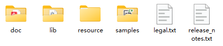
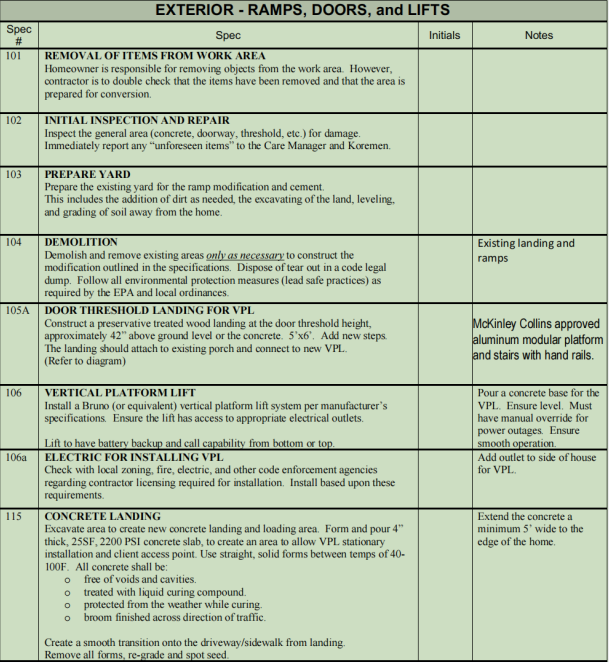
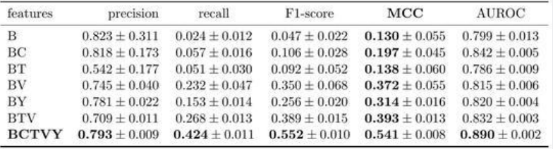

# 1. Overview

PDFSolid Conversion SDK is a high-performance library designed for extracting and transforming the data within your PDF files, such as text, images, tables, links, and annotations, into various file formats. Our Conversion SDK retains the original document layout and the properties of the file data, ensuring a seamless document conversion experience.

Effortlessly integrate the PDFSolid Conversion SDK into your projects in just a few steps, and enable the following file format conversions:

- Convert PDF to Word (.docx)
- Convert PDF to Excel (.xlsx)
- Convert PDF to PowerPoint (.pptx)
- Convert PDF to HTML (.html)
- Convert PDF to CSV (.csv)
- Convert PDF to Image (.png, .jpg, .jpeg, .jpeg2000, .bmp, .tiff, .tga, .gif, .webp)
- Convert PDF to Plain Text (.txt)
- Convert PDF to Rich Text Format (.rtf)

- Convert PDF to Searchable PDF (.pdf)


- Convert PDF to OFD (.ofd)

- Convert PDF to Structured Data (.json)
- Convert PDF to Markdown (.md)
- Convert Word to PDF (.docx to .pdf)
- Convert supported image inputs to images, including individual frames of multi-page TIFF files.


Harness the power of PDFSolid Conversion SDK and take your document processing to the next level with intelligent tools designed for accuracy and efficiency. To enhance your format conversion results, PDFSolid offers AI-powered document tools with the following capabilities:


- Optical Character Recognition (OCR)


- Layout Analysis


- Table Recognition


## 1.1 Why PDFSolid Conversion SDK

- Mature Technology

  With years of technology accumulation, we have established a complete mechanism of product iteration to offer a continuous guarantee for product competitiveness.

- Complete PDF and Format Conversion Functionalities

  Our comprehensive features can meet diverse needs and are easy for our customers to use without training costs.

- High-quality Service

  professional service and technical support to quickly respond to users' feedback through onsite service or remote support like telephone, email, etc.

- Independent Intellectual Property Rights

  Our technology is independent and compliant with ISO, helping enterprises conduct international business without considering copyright risks.

## 1.2 PDFSolid Conversion SDK

The PDFSolid Conversion SDK is designed to facilitate the effortless conversion of PDF files into various other formats, all while preserving the original layout and formatting of the documents. In this guide, we will explore the PDFSolid Conversion SDK and demonstrate how to utilize it within your Objective-C projects.

## 1.3 License & Trial

The PDFSolid Conversion SDK is a commercial SDK that requires a license to grant developers the right to develop and distribute their applications. In development mode, each license is only valid for one device ID. PDFSolid provides flexible licensing models, please contact [our sale's team](mailto:support@pdfsolid.com) for more information. However, even if you have a license, it is prohibited to distribute any documents, sample code, or source code of the PDFSolid Conversion SDK to any third parties.

If you do not have a License, please feel free to contact the PDFSolid Team (support@pdfsolid.com) to obtain a License to try the PDFSolid Conversion SDK.
# 2. Getting Started

## 2.1 Requirements
Before starting, please make sure that you have already met the following prerequisites.

### 2.1.1 Get PDFSolid License Key

PDFSolid provides two types of license key: 30-day free trial license, and commercial license.

#### How to Get Free Trial License

Contact our sales team (support@pdfsolid.com) and we'll send you a 30-day free trial license for PDFSolid Conversion SDK.

#### How to Get Commercial License

PDFSolid Conversion SDK is a commercial SDK that requires a license for application release. Any documents, sample code, or source code distribution from the released package of PDFSolid to any third party is prohibited.

**Contact Sales**

To get commercial license for PDFSolid Conversion SDK, feel free to contact our sales team (support@pdfsolid.com).

For Objective-C Conversion SDK, the formal license must be bound to your developer device ID (How to find the developer device ID), and each license is only valid for one device ID in development mode.


### 2.1.2 Download Conversion SDK

Contact us (support@pdfsolid.com) to obtain the PDFSolid Conversion SDK.


### 2.1.3 System Requirements

| Platform | System Requirements | Development Environment | Notes |
| :------ | :------ | :------ | :------ |
| Mac | - macOS 11.0 or later (Intel x86_64 and Apple Silicon arm64). | Install Xcode 13.0 or later. | Samples have been tested on Mac Intel and Mac Apple Silicon. |
| iOS | - iOS 13.0 or later (arm64 physical devices only; separate iOS SDK package, no simulator slice). | Install Xcode 13.0 or later and iOS SDK 13.0 or above. | Samples have been tested on iOS physical devices. |

## 2.2 SDK Package Structure

You can contact us (support@pdfsolid.com) to get the PDFSolid Conversion SDK for Objective-C package. The package contains the following files:


- ***"doc"*** - API reference and developer guide.
- ***"lib"*** - A folder containing Objective-C SDK dynamic libraries or frameworks.
- ***"samples"*** - A folder containing Objective-C sample projects.
- ***"resource"*** - Contains DocumentAI model resources.
- ***"release_notes.txt"*** - Release notes.
- ***"legal.txt"*** - Legal and copyright information.



**About AI model files:** The SDK package bundles the base model `documentai.model` by default, so the default configuration (layout analysis, OCR, and balanced-profile table recognition) needs no extra download. Download the corresponding extension model packages only when you need extended capabilities such as high-accuracy table recognition, high-accuracy OCR, or document orientation classification and correction. See "Model Package Reference" in the "Set DocumentAI Model" chapter.
### 2.2.1 Apply the License Key
If you don't have a license key, please check out [how to obtain a license key](#211-get-pdfsolid-license-key).

PDFSolid Conversion SDK currently supports offline authentication to verify license keys.

*Learn about:*

*What is the authentication mechanism of PDFSolid's license?*

#### Copy the License Key

Accurately obtaining the license key is crucial for the application of the license.

1. In the email you received, locate the XML file containing the license key.
2. Open the XML file, and determine the license type based on the `<type>` field. If `<type>online</type>` is present, it indicates an online license. If `<type>offline</type>` is present or if the field is absent, it indicates an offline license.

**Online License**:

```xml
<?xml version="1.0" encoding="UTF-8" standalone="no"?>
<license version="1">
    <platform>mac</platform>
    <starttime>xxxxxxxx</starttime>
    <endtime>xxxxxxxx</endtime>
    <type>online</type>
    <key>LICENSE_KEY</key>
</license>

```

**Offline License**:

```xml
<?xml version="1.0" encoding="UTF-8" standalone="no"?>
<license version="1">
    <platform>mac</platform>
    <starttime>xxxxxxxx</starttime>
    <endtime>xxxxxxxx</endtime>
    <key>LICENSE_KEY</key>
</license>

```

3. Copy the value located at the LICENSE_KEY position within the `<key>LICENSE_KEY</key>` field. This is your license key.

#### Apply the License Key
You can perform offline authentication using the following method:

Before using the classes and methods of the PDFSolid Conversion SDK in your project, you need to initialize the SDK with a valid license key. If you don’t have a license key, feel free to contact the PDFSolid team (support@pdfsolid.com) to obtain one.

```objective-c
#import <Foundation/Foundation.h>
#import "conversion.h"
#import "common.h"

ErrorCode code = [LibraryManager licenseVerify:@"<your_license_string>"];
if (code != ErrorCodeSuccess) {
    return;
}

ErrorCode xmlCode = [LibraryManager licenseVerify:@"/path/to/license.xml"];
if (xmlCode != ErrorCodeSuccess) {
    return;
}
```

#### Query the License Type

After the license is verified, call `[LibraryManager getLicenseType]` to get the type of the currently verified license. It does not verify the license again and does not consume page quota.

| Return value | Meaning |
| --- | --- |
| `LicenseTypeUnknown` (0) | No license has been verified, verification failed, or the SDK is releasing |
| `LicenseTypeTrial` (1) | Trial license |
| `LicenseTypeFormal` (2) | Formal license |

```objective-c
LicenseType type = [LibraryManager getLicenseType];
if (type == LicenseTypeTrial) {
    // Trial license.
}
```

## 2.3 How to Run a Demo

PDFSolid Conversion SDK provides demos in the **"samples"** folder.

#### Mac

1. Open a terminal window and navigate to the **"samples"** folder of the Mac SDK package.
2. Enter the following command to run the demo:

```shell
./RunDemo.sh
```

Output files will be generated in the **"samples/output_files"** folder.

#### iOS

1. Open the `IOS_demo.xcodeproj` file in the `samples` folder.
2. Connect an iOS device and select the target device in Xcode.
3. Click Build and Run to run the demo.
# 3. Conversion Guides

In addition to PDF export, the SDK converts Word (`.docx`) to PDF with optional page ranges and bookmarks. See [Convert Word to PDF](#323-convert-word-to-pdf).

PDFSolid Conversion SDK allows developers to use a simple API to convert PDF to commonly used file
formats such as Word, Excel, PowerPoint, HTML, CSV, PNG, JPEG, RTF, TXT, Searchable PDF, OFD, JSON, and Markdown. It provides a wide range of customized conversion
options, such as whether to include images or annotations in PDF documents, whether to enable OCR, whether to enable layout analysis, and more.
## 3.1 Initialize Library Resources

#### **Overview**

Initialize the necessary file and memory resources required by the PDFSolid Conversion SDK.

#### **Notes**

- You must initialize SDK resources before calling any conversion interface.

- When using OCR, Layout Analysis, PDF to Searchable PDF, or PDF to OFD, make sure the font resources and DocumentAI model resources in the `resource` directory are available.

- Lifecycle: if synchronous conversion tasks are still running when `[LibraryManager release]` is called, the release is deferred until the last task returns, and new tasks are refused in the meantime. Unload the SDK only after all conversion calls have returned. See "Release Library Resources" for details.

- Office fonts: on macOS, initialization also scans the font directories of Microsoft Office (the fonts inside Word's application bundle and the Office cloud-font cache) so that these fonts can be used during conversion. The cloud-font cache lives in another app's container, and reading it makes macOS 15 and later ask the user to allow access to other apps' data. To avoid the prompt, call `[LibraryManager initialize:scanOfficeFonts:]` with `NO`; the Office fonts are then not used.


#### **Example**

```objective-c
[LibraryManager initialize:@"PDFSolid_Conversion_SDK/resource"];
```
## 3.2 Set DocumentAI Model

#### **Overview**

Before using OCR, Layout Analysis, Table Recognition you need to set the DocumentAI model path first.

The SDK package bundles the base model `documentai.model` by default. With the default configuration you only need to pass its path to `setDocumentAIModel`; no extra download is required.

`setDocumentAIModel` supports an optional `gpuId` parameter used to specify the GPU device index for the AI model. When `gpuId` is `-1`, GPU acceleration is disabled.

#### **Set AI Model Instance Count**

If you need to control the number of Layout Analysis and Table Recognition model instances, call the corresponding interface to set the model instance counts.


#### **Use Your Own AI Engine (SDK v1.1.0+)**

This option is available only in SDK v1.1.0 or later. You can skip `setDocumentAIModel` and plug in your own OCR, Layout Analysis, or Table Recognition engine through the callbacks on `ConvertCallback`. See [3.11 Use Custom AI Models via Callbacks](#311-use-custom-ai-models-via-callbacks) for details.


#### **Sample**

```objective-c
[LibraryManager setDocumentAIModel:@"path/documentai.model"];
[LibraryManager setDocumentAIModel:@"path/documentai.model" gpuId:-1];
[LibraryManager setDocumentAIModelCount:1 tableModelCount:1];
```

#### **Incremental Loading of Model Packages**

Models are provided as packages. Each call to `setDocumentAIModel` loads only the capabilities contained in that file and **merges them with the capabilities already loaded instead of replacing them**; the loading order does not matter. If a package fails to load, **the capabilities already loaded are kept** and a specific error code is returned; there is no silent downgrade.

Calling `releaseDocumentAIModel` releases all loaded models; load them again before using AI features afterwards. While conversion tasks are running or a release is still pending, reconfiguring the DocumentAI model is refused and `ErrorCodeConverting` is returned. Load or reload models only after all conversion tasks have finished.

```objective-c
// Load the base package.
[LibraryManager setDocumentAIModel:@"path/documentai.model"];
// Load an extension package when you need the extended capability.
// Capabilities that are already loaded are kept.
[LibraryManager setDocumentAIModel:@"path/table_legacy.model"];
```

#### **Model Package Reference**

Extension model packages are available separately when extended capabilities are required.

| File | Size | Purpose | How to obtain / When needed |
| --- | --- | --- | --- |
| `documentai.model` | About 230 MB | Base package: layout analysis, table recognition (balanced profile), and all basic OCR languages | Bundled in the SDK package; required by every AI feature (layout analysis, OCR, table recognition) |
| `table_legacy.model` | About 270 MB | Table extension package: resources such as bordered / borderless table detection required by the high-accuracy profile | Download separately; needed only when `tableRecognitionAccuracy` is set to `TableRecognitionAccuracyHighAccuracy` (high accuracy); not needed for the default balanced profile |
| `ocr_server.model` | About 139 MB | High-accuracy OCR package covering Chinese, English, Japanese, and other languages | Download separately; needed when you require higher OCR accuracy |
| `document_process.model` | About 37 MB | Document orientation classification and skew correction | Download separately; needed when `enableDocumentOrientationClassification` (orientation classification) or `enableDocumentDewarp` (correction) is used |

**If you do not need extended capabilities, you do not need to download any extension package**: the default configuration only uses the `documentai.model` bundled in the SDK package.

#### **Version Compatibility**

- Model packages must match the SDK version. The `documentai.model` bundled in the SDK package is already the matching version; download extension packages of the same version as the SDK.
- The `documentai.model` of 1.2.0 and earlier **does not contain** the resources required by the balanced profile, while 1.3.0 keeps the same file name. **If you copied the old `documentai.model` into your own deployment directory or project, overwrite it with the file from the new SDK package when upgrading instead of keeping the old file.** Loading an old model returns an error; there is no automatic fallback to the high-accuracy profile.
- Do not replace only the framework and dynamic libraries or only the model files; update them together.

#### **FAQ**

| Symptom | Possible cause |
| --- | --- |
| `setDocumentAIModel` returns an error | Wrong path; the model file does not match the SDK version; the file is incomplete (interrupted download) |
| Tables look different from (or worse than) expected after `tableRecognitionAccuracy` is set to `TableRecognitionAccuracyHighAccuracy` | `table_legacy.model` has not been loaded (tables fell back to rule-based recognition) |
| `ErrorCodeLicenseOCRPermissionDeny` (29) is returned during conversion | The license does not include the OCR permission; unrelated to the model |

## 3.3 Get Conversion Progress

PDFSolid Conversion SDK obtains the conversion progress through callback functions. The following example demonstrates how to get the conversion progress while performing a PDF to Word task.


```objective-c
WordOptions *options = [[WordOptions alloc] init];
[CPDFConversion startPDFToWord:@"input.pdf"
                      password:@"password"
                    outputPath:@"path/output.docx"
                       options:options
                      progress:^(int currentPage, int totalPage) {
    NSLog(@"progress: %d / %d", currentPage, totalPage);
}
                        cancel:nil];
```
## 3.4 Cancel Conversion Task

PDFSolid Conversion SDK supports interrupting your ongoing conversion task at any time. The following example demonstrates how to interrupt your ongoing conversion task.


```objective-c
__block BOOL shouldCancel = NO;

WordOptions *options = [[WordOptions alloc] init];
[CPDFConversion startPDFToWord:@"input.pdf"
                      password:@"password"
                    outputPath:@"path/output.docx"
                       options:options
                      progress:nil
                        cancel:^BOOL{
    return shouldCancel;
}];
```
## 3.5 Select Page Range for Conversion

PDFSolid Conversion SDK supports converting a specified page range. When an empty string is passed, all pages will be converted. If the page range exceeds one page, you can also choose to enable the `output_document_per_page` option to output each PDF page as a separate file. The following example demonstrates how to specify a page range when performing a conversion task:

```objective-c
WordOptions *options = [[WordOptions alloc] init];
options.output_document_per_page = YES;
options.pageRanges = @"1-3,5,7-9";
```
## 3.6 Conversion Options: Contain Image & Annotation

#### **Overview**

In the process of converting PDF documents into various formats, PDFSolid Conversion SDK offers two additional options for users: one option to determine whether images are included in the generated document, and another to decide if annotations from the PDF file are to be retained.

- With the "Include Images" option enabled, PDFSolid Conversion SDK will extract the images from the PDF document and embed them in the corresponding pages and positions in the output file. For areas with overlapping images, PDFSolid Conversion SDK merges these images into one and embeds it into the exact location on the corresponding page of the output file.

- When the "Include Annotations" option is selected, most annotations are converted into raster images and embedded at the respective positions within your document. However, certain types of annotations, such as highlights, underlines, strikeouts, and squiggly, are converted into their respective formatting equivalents in the converted Word, PPT, and HTML documents, and are marked over the corresponding text. It is important to note that the conversion won't be 100% accurate in every instance.

In the PDFSolid Conversion SDK, the options for including images and annotations are commonly used in the following format conversions:

- PDF to Word
- PDF to Excel
- PDF to PowerPoint
- PDF to HTML
- PDF to RTF
- Extract PDF to JSON
- Extract PDF to Markdown

#### **About Text Markup Annotation**

- **Highlight:** When converting PDF to Word format keeping the highlight markups, it is important to note that Microsoft Word only supports 15 highlighter colors. To approximate the original document's appearance as closely as possible, text in the Word document will be marked with a text background color that matches the color of the original document's highlight annotation. For conversions to Microsoft PPT format, the native highlighting feature within the format is used to mark the text. In the case of converting to HTML format, a unique `<span>` tag is created for the marked text, and the background style is set to match the color of the corresponding annotation in the original document.

- **Underlines & Squiggly:** When converting PDF to Word or PPT formats keeping the underline and squiggly markups, the marked text will be marked with the same style in Microsoft Office. When converted to HTML format, the marked text will be styled to display the same effect. However, if a paragraph of text in the original document is marked by both underline and squiggly, then the text will only be marked with one type (Because squiggly is actually a type of underline in Word, PPT, and HTML formats).
  
- **Strikeout:** When converting strikeout markups to Word and PowerPoint formats, the marked text will be added with a strikeout natively supported by Microsoft Office. However, in these two file formats, the color of the strikeout itself cannot be the same as that in the original PDF document because the strikeout color in Word and PPT will only change according to the color of the marked text font itself. When converted to HTML format, the same strikeout color as the original document will be displayed.
  

#### **Sample**

This Sample demonstrates how to use the PDFSolid Conversion SDK to convert a PDF document to a Word document with the selected options: Include images and annotations.

```objective-c
WordOptions *options = [[WordOptions alloc] init];
options.containImage = YES;
options.containAnnotation = YES;
[CPDFConversion startPDFToWord:@"input.pdf" password:@"password" outputPath:@"path/output.docx" options:options];
```
## 3.7 Page Layout Mode

In certain formats, the page layout mode plays a key role in the quality of the converted document. PDFSolid Conversion SDK supports two layout modes: Flow Layout and Box Layout.

- **Flow Layout:** This layout uses paragraph indentations, columns, and tab positions to adjust the content. Its main advantage is flexibility; content can flow automatically as the document is edited, and it adapts to various screen sizes on different devices. This layout also supports structured maintenance and can implement consistent global formatting through style templates (e.g., titles, body text). Common use cases include documents that are frequently modified, such as reports, manuals, and dynamic tables.
- **Box Layout:** Based on the PDF's "digital paper" model, this layout accurately positions every element (text, images, tables) on the page using a coordinate system (e.g., text is positioned 5 cm from the top and 3 cm from the left). The main advantage is high-precision rendering, which ensures consistency across different platforms. This layout is particularly useful for documents requiring precise reproduction, such as contracts, design drafts, and academic papers.

In the PDFSolid Conversion SDK, page layout modes are commonly used in the following format conversions:

- PDF to Word
- PDF to HTML

#### **Sample**

This example demonstrates how to convert a PDF document to Word with Flow Layout and Box Layout:

```objective-c
WordOptions *options = [[WordOptions alloc] init];
options.pageLayoutMode = PageLayoutModeFlow;
[CPDFConversion startPDFToWord:@"input.pdf" password:@"password" outputPath:@"path/output-flow.docx" options:options];

options.pageLayoutMode = PageLayoutModeBox;
[CPDFConversion startPDFToWord:@"input.pdf" password:@"password" outputPath:@"path/output-box.docx" options:options];
```
## 3.8 OCR

#### **Overview**

OCR (Optical Character Recognition) is the process of converting images of typed, handwritten, or printed text into machine-encoded text.

OCR is commonly used for text recognition and extraction from the following types of documents:

- Non-editable scanned PDF files
- Photographs of documents.
- Scene photos such as advertising layouts, signboards, etc.
- Identification cards, passports, vehicle license plates, and other official plates.
- Invoices, bills, receipts, and other financial documents.

The following features support OCR:

- PDF to Word
- PDF to Excel
- PDF to PowerPoint (PPT)
- PDF to HTML
- PDF to Rich Text Format (RTF)
- PDF to Text (TXT)
- PDF to CSV
- PDF to Searchable PDF
- PDF to OFD
- Extract PDF to JSON
- Extract PDF to Markdown


OCR Language Support of PDFSolid Conversion SDK:

| Script / Notes | Language (Native)                           | Language (In English)       |
| -------------- | ------------------------------ | ---------------------- |
| Latn; American | English                        | English               |
| Latn; Canadian | Français canadien              | French                |
| Hans/Hant      | 中文简体                       | Chinese (Simplified)  |
| Hans/Hant      | 中文繁体                       | Chinese (Traditional) |
| Jpan           | 日本語                         | Japanese              |
| Kore           | 한국어                         | Korean                |
| Latn           | Deutsch                        | German              |
| Latn           | Српски (латиница)              | Serbian (latin)       |
| Latn           | Occitan, lenga d'òc, provençal | Occitan               |
| Latn           | Dansk                          | Danish                |
| Latn           | Italiano                       | Italian               |
| Latn; European | Español                        | Spanish               |
| Latn; European | Português (Portugal)           | Portuguese            |
| Latn           | Te reo Māori                   | Maori                 |
| Latn           | Bahasa Melayu                  | Malay                 |
| Latn           | Malti                          | Maltese               |
| Latn           | Nederlands                     | Dutch                 |
| Latn; Bokmål   | Norsk                          | Norwegian             |
| Latn           | Polski                         | Polish                |
| Latn           | Română                         | Romanian              |
| Latn           | Slovenčina                     | Slovak                |
| Latn           | Slovenščina                    | Slovenian             |
| Latn           | shqip                          | Albanian              |
| Latn           | Svenska                        | Swedish               |
| Latn           | Swahili                        | Swahili               |
| Latn           | Wikang Tagalog                 | Tagalog               |
| Latn           | Türkçe                         | Turkish               |
| Latn           | oʻzbekcha                      | Uzbek                 |
| Latn           | Tiếng Việt                     | Vietnamese            |
| Latn           | Afrikaans                      | Afrikaans             |
| Latn           | Azərbaycan                     | Azerbaijani           |
| Latn           | Bosanski                       | Bosnian               |
| Latn           | Čeština                        | Czech                 |
| Latn           | Cymraeg                        | Welsh                 |
| Latn           | Eesti keel                     | Estonian              |
| Latn           | Gaeilge                        | Irish                 |
| Latn           | Hrvatski                       | Croatian              |
| Latn           | Magyar                         | Hungarian             |
| Latn           | Bahasa Indonesia               | Indonesian            |
| Latn           | Íslenska                       | Icelandic             |
| Latn           | Kurdî                          | Kurdish               |
| Latn           | Lietuvių                       | Lithuanian            |
| Latn           | Latviešu                       | Latvian               |

#### **Set OCR Language**

In the current mainline version, OCR languages should be passed through the `options.languages` for each conversion task, rather than through a separate global interface.

```objective-c
[LibraryManager setDocumentAIModel:@"path/documentai.model"];

WordOptions *options = [[WordOptions alloc] init];
options.enableOCR = YES;
options.ocrOption = OCROptionInvalidCharacterAndScanPage;
options.contain_page_background_image = YES;
options.languages = @[@(OCRLanguageChinese)];

[CPDFConversion startPDFToWord:@"word.pdf" password:@"password" outputPath:@"path/output.docx" options:options];
```

#### **OCR Options**
Different OCR options can be selected according to actual needs. Below are the currently supported OCR options.

- **OCROptionInvalidCharacter:** Recognizes invalid or garbled characters in the PDF document through OCR, while normal characters are not processed by OCR.
- **OCROptionScanPage:** Recognizes scanned pages in the PDF document through OCR, while editable pages are not processed by OCR.
- **OCROptionInvalidCharacterAndScanPage:** Recognizes both invalid characters and scanned pages in the PDF document through OCR.
- **OCROptionAll:** Recognizes all pages and characters in the PDF document through OCR.

#### **Preserve Page Background**
When OCR is enabled, you can choose whether to enable the `contain_page_background_image` option. If this option is enabled, the original page background image of the PDF will be preserved. If it is disabled, the image result detected during page layout analysis will be retained.

#### **Orientation Classification and Dewarping before OCR**

- `enableDocumentOrientationClassification`: classifies and corrects the document orientation before OCR image recognition. Disabled by default.
- `enableDocumentDewarp`: corrects curved or skewed document images before OCR image recognition. Disabled by default.
- Both options only take effect when OCR is enabled and require the additional `document_process.model` package (see "Model Packages" in "Set DocumentAI Model"). PDF to Image does not use them.

#### **Notice**

- The quality of the OCR result depends on the quality of the input image. If the input image has a low resolution, the OCR result quality will be affected. A good rule of thumb is that the more pixels in the character shapes, the better. If the character bounding box is smaller than 20x20 pixels, OCR quality will drop exponentially. The ideal image is a grayscale image with a resolution around 300 DPI.
- When performing OCR, make sure the OCR language setting matches the language in the PDF document to achieve the best OCR conversion quality.
- OCR functionality is currently not supported on iOS.


#### **Convert Images to Other Document Formats**

The OCR function also supports converting input images into Word, Excel, PPT, HTML, CSV, RTF, TXT, JSON, and other formats. This sample demonstrates how to use the PDFSolid OCR function to convert image files to a DOCX file.

```objective-c
[LibraryManager setDocumentAIModel:@"path/documentai.model"];

WordOptions *options = [[WordOptions alloc] init];
options.enableOCR = YES;
options.languages = @[@(OCRLanguageChinese)];

[CPDFConversion startPDFToWord:@"input.png" password:@"" outputPath:@"path/output.docx" options:options];
```

#### **Sample**

This Sample demonstrates how to use the PDFSolid OCR function to convert a PDF to DOCX file.

```objective-c
[LibraryManager setDocumentAIModel:@"path/documentai.model"];

WordOptions *options = [[WordOptions alloc] init];
options.enableOCR = YES;
options.ocrOption = OCROptionInvalidCharacterAndScanPage;
options.contain_page_background_image = YES;
options.languages = @[@(OCRLanguageChinese)];

[CPDFConversion startPDFToWord:@"word.pdf" password:@"password" outputPath:@"path/output.docx" options:options];
```
## 3.9 Layout Analysis

#### **Overview**

Layout analysis is the process of leveraging Artificial Intelligence (AI) technology to parse and understand the structure of a document's layout. Its primary goal is to extract text, images, tables, layers, and other data from the input documents.

Layout analysis has several common use cases, including:

- **Intelligent recognition of tables within PDF documents**: This feature is particularly useful for analyzing company financial statements, invoices, bank statements, experimental data, medical test reports, and more.
- **Smart extraction of text, images, or tables from PDF documents through layout analysis**: This functionality greatly aids in the analysis and extraction of information from identification cards, receipts, licenses, documents, ancient books, and other various types of files.

Features that support Layout Analysis:

- PDF to Word
- PDF to Excel
- PDF to PowerPoint (PPT)
- PDF to HTML
- PDF to RTF
- PDF to TXT
- PDF to CSV
- Extract PDF to JSON
- Extract PDF to Markdown

#### **Notice**

- You need to load the DocumentAI model (see [3.2 Set DocumentAI Model](#32-set-documentai-model)) before using layout analysis, **or** plug in your own layout model through the callbacks described in [3.11 Use Custom AI Models via Callbacks](#311-use-custom-ai-models-via-callbacks).
- When OCR is enabled, layout analysis is automatically enabled.
- AI table recognition is a separate stage controlled by `enableAITableRecognition`. See [3.10 Table Recognition](#310-table-recognition).

#### **Sample**

This Sample demonstrates how to use the PDFSolid OCR function to convert PDF to DOCX file.

```objective-c
[LibraryManager setDocumentAIModel:@"path/documentai.model"];

WordOptions *options = [[WordOptions alloc] init];
options.enableAILayout = YES;
[CPDFConversion startPDFToWord:@"input.pdf" password:@"password" outputPath:@"path/output.docx" options:options];
```
## 3.10 Table Recognition

#### **Overview**

Table Recognition reconstructs the internal structure of tables detected during layout analysis, including rows, columns, merged cells, and cell boundaries, so that the converted document preserves the original tabular semantics instead of producing a flat grid of text fragments.

It is controlled by the independent option `enableAITableRecognition`, which is **enabled by default**. The table model is only invoked for table regions reported by layout analysis whose detection confidence is below the trusted threshold; high-confidence native PDF tables bypass the model to save inference time.

Typical scenarios that benefit from Table Recognition:

- **Borderless or partially bordered tables**, where ruling lines alone cannot describe the structure.
- **Tables with merged header cells, multi-row headers, or spanning cells**, such as financial statements, lab reports, and invoices.
- **Scanned tables processed by OCR**, where geometric reconstruction is required before cell-level data extraction.

Features that support Table Recognition:

- PDF to Word
- PDF to Excel
- PDF to PowerPoint (PPT)
- PDF to HTML
- PDF to RTF
- PDF to CSV
- Extract PDF to JSON
- Extract PDF to Markdown

#### **Notice**

- Table Recognition runs only when layout analysis is active (i.e. `enableAILayout` is enabled, or implicitly when `enableOCR` is enabled).
- You need to load the DocumentAI model before using Table Recognition, **or** plug in your own table model via the callbacks described in [3.11 Use Custom AI Models via Callbacks](#311-use-custom-ai-models-via-callbacks).
- Disabling `enableAITableRecognition` turns the table model off entirely; detected table regions then fall back to geometric reconstruction from the underlying page objects.

#### **Sample**

This sample demonstrates how to convert a PDF to a Word document with Table Recognition enabled.

```objective-c
[LibraryManager setDocumentAIModel:@"path/documentai.model"];

WordOptions *options = [[WordOptions alloc] init];
options.enableAILayout = YES;
options.enableAITableRecognition = YES; // enabled by default in 4.1
[CPDFConversion startPDFToWord:@"input.pdf" password:@"password" outputPath:@"path/output.docx" options:options];
```

#### **Table Recognition Model Profile**

Table Recognition provides two model profiles, selected per conversion task through `tableRecognitionAccuracy` (type `TableRecognitionAccuracy`):

| Profile | Meaning |
| --- | --- |
| `TableRecognitionAccuracyHighAccuracy` | Prioritizes recognition accuracy and may use more resources. **The default behavior of 1.2.0** |
| `TableRecognitionAccuracyBalanced` | Balances recognition accuracy, resource usage, and throughput. **The default since 1.3.0** |

- **Default changed:** 1.2.0 used the high-accuracy profile by default, while 1.3.0 uses the balanced profile by default. Even without code changes, table recognition results and resource usage after upgrading differ from 1.2.0.
- The balanced profile only needs the base package `documentai.model` bundled in the SDK package; **the high-accuracy profile additionally requires the table extension package `table_legacy.model`** (see "Model Package Reference" in the "Set DocumentAI Model" chapter).
- Models of both profiles can be loaded at the same time; each conversion task uses the one selected by its `tableRecognitionAccuracy`.
- If the requested profile has no corresponding model (for example, the high-accuracy profile without `table_legacy.model`), the conversion still succeeds, but tables are recognized with the rule-based method instead, so the result differs from that profile.
- The profile names do not guarantee better results for every document.

```objective-c
[LibraryManager setDocumentAIModel:@"path/documentai.model"];
[LibraryManager setDocumentAIModel:@"path/table_legacy.model"];

WordOptions *options = [[WordOptions alloc] init];
// Use the high-accuracy profile (requires table_legacy.model to be loaded).
options.tableRecognitionAccuracy = TableRecognitionAccuracyHighAccuracy;
[CPDFConversion startPDFToWord:@"input.pdf" password:@"password" outputPath:@"path/output.docx" options:options];
```

## 3.11 Use Custom AI Models via Callbacks

#### **Overview**

Starting with **SDK v1.1.0**, PDFSolid Conversion SDK exposes a callback-based extension point that lets you plug in your own AI inference engine for OCR, Layout Analysis, and Table Recognition. Instead of relying on the built-in DocumentAI model loaded by `setDocumentAIModel`, you can:

- Run inference with any model or runtime you choose (e.g. your in-house engine, PaddleOCR, a cloud OCR API).
- Return the result to the SDK as a JSON string with a well-defined schema.

When the relevant callback pair is registered on `ConvertCallback`, the SDK skips its built-in model invocation for that capability and consumes your JSON output instead. If a pair is left unset, the SDK falls back to the built-in DocumentAI model (when available).

#### **Callback Pairs**

Each AI capability uses **two callbacks**: a *trigger* (invoked by the SDK with the path to a page image saved as PNG in a temp directory) and a *result getter* (invoked by the SDK immediately afterwards to retrieve the JSON string).

| Capability         | Trigger field / setter             | Result getter field / setter                | Triggered when                                                                              |
| ------------------ | ---------------------------------- | ------------------------------------------- | ------------------------------------------------------------------------------------------- |
| OCR                | `ocr`                              | `get_ocr_result`                            | OCR is enabled                                                                              |
| Layout Analysis    | `layout`                           | `get_layout_result`                         | layout analysis is enabled (or implicitly when OCR is enabled)                              |
| Table Recognition  | `table`                            | `get_table_result`                          | table recognition is enabled **and** a table region is detected by layout analysis          |

Rules:

- The trigger receives a UTF-8 path to a PNG file. Return `true` if your inference succeeded, `false` to make the SDK ignore the result for that page.
- The getter must return a UTF-8 JSON string. The SDK copies the string into an internal buffer before consuming it.
- Both callbacks for a capability must be set together. If only one is provided, the SDK falls back to the built-in path.
- Coordinates in your JSON must be in the **pixel space of the image the trigger received** (top-left origin, X right, Y down).
- Confidence filtering: OCR spans with `confidence < 0.1` and layout objects with `confidence < 0.45` are discarded by the SDK.
- When all three capabilities you need are covered by your own callbacks, `setDocumentAIModel` does not have to be called.

#### **Sample**

```objective-c
@interface CustomAICallback : NSObject <ConvertCallback>
@property (nonatomic, copy) NSString *ocrResultJson;
@property (nonatomic, copy) NSString *layoutResultJson;
@property (nonatomic, copy) NSString *tableResultJson;
@end

@implementation CustomAICallback
- (void)onProgress:(int)currentPage totalPage:(int)totalPage {}
- (BOOL)isCancelled { return NO; }

- (BOOL)onOcr:(NSString *)imagePath {
    // Run your OCR engine on `imagePath`, cache the JSON result.
    self.ocrResultJson = @"{}";
    return YES;
}
- (BOOL)onLayout:(NSString *)imagePath {
    self.layoutResultJson = @"{}";
    return YES;
}
- (BOOL)onTable:(NSString *)imagePath {
    self.tableResultJson = @"{}";
    return YES;
}

- (NSString *)getOcrResult    { return self.ocrResultJson; }
- (NSString *)getLayoutResult { return self.layoutResultJson; }
- (NSString *)getTableResult  { return self.tableResultJson; }
@end

WordOptions *options = [[WordOptions alloc] init];
options.enableOCR = YES;
options.enableAILayout = YES;
options.enableAITableRecognition = YES;
CustomAICallback *callback = [[CustomAICallback alloc] init];
[CPDFConversion startPDFToWord:@"input.pdf"
                      password:@"password"
                    outputPath:@"path/output.docx"
                       options:options
                      callback:callback];
```

#### **JSON Schemas**

The expected JSON schema for each capability, including field names, coordinate space (pixel space of the image the trigger received), and value ranges, is the same across all language bindings. See the C++ developer guide chapter [Use Custom AI Models via Callbacks](https://github.com/PDFSolid/pdfsolid-conversion-mac-cpp/blob/main/doc/developer_guide_c%2B%2B.md#312-use-custom-ai-models-via-callbacks).
## 3.12 Output Font Option

#### **Overview**

In some output formats, you can set the preferred font name to unify the default font style in the output document.

#### **Supported Formats**

The `fontName` option currently applies to the following formats:

- PDF to Word
- PDF to Excel
- PDF to PowerPoint

#### **Example**

The following example demonstrates how to set the preferred font name for the output document.

```objective-c
WordOptions *options = [[WordOptions alloc] init];
options.fontName = @"Arial";
[CPDFConversion startPDFToWord:@"word.pdf" password:@"password" outputPath:@"path/output.docx" options:options];
```
## 3.13 Convert PDF to Word

#### **Overview**

Converting PDF to Word is an operation that converts a PDF file into an editable Word file. By converting PDF to Word, you can easily edit, modify, insert, or delete text and images, and adjust layout and properties.

#### **Layout differences**

- **Flow Layout:** Ideal for editing, with content dynamically adapting to different positions as you edit. However, a Word file may display differently because of incompatibilities across software or application versions. This makes it unsuitable for highly precise documents such as certificates or formal electronic records.
  
- **Fixed Layout:** Ensures a stable, uniform appearance and print quality across all devices. The content and formatting are locked upon creation, making alterations difficult without affecting the overall layout. It's preferred for formal documentation such as business reports and official electronic records.

#### **Sample**

This sample demonstrates how to convert from a PDF to DOCX file.

```objective-c
WordOptions *options = [[WordOptions alloc] init];
options.pageLayoutMode = PageLayoutModeBox;
[CPDFConversion startPDFToWord:@"word.pdf" password:@"password" outputPath:@"path/output-box.docx" options:options];

options.pageLayoutMode = PageLayoutModeFlow;
[CPDFConversion startPDFToWord:@"word.pdf" password:@"password" outputPath:@"path/output-flow.docx" options:options];
```

#### **Convert Formulas to Images**

When a document contains complex formulas and you want to preserve visual consistency in the output document, you can enable the `formulaToImage` option.

```objective-c
WordOptions *options = [[WordOptions alloc] init];
options.formulaToImage = YES;
[CPDFConversion startPDFToWord:@"word.pdf" password:@"password" outputPath:@"path/output.docx" options:options];
```
## 3.14 Convert PDF to Excel

#### **Overview**

PDFSolid Conversion SDK supports converting PDF documents to Microsoft Excel format (.xlsx). By extracting, parsing, and importing data from PDF into Excel, users can further edit, analyze, or share Excel files. This feature helps increase productivity, reduce manual entry errors, and simplify complex document processing tasks.

#### **Set the content options for Excel**

When converting PDF files to Excel files, you need to pay attention to the settings of the following options, which will directly affect the content written to the Excel file.

- Content options:

  If you set the `AllContent` option, the converted XLSX file will contain all content in the PDF.

- Worksheet options:

| Option | Description |
| --- | --- |
| `ExcelWorksheetForTable` | Create one sheet per table. |
| `ExcelWorksheetForPage` | Create one sheet per page. |
| `ExcelWorksheetForDocument` | Create one sheet for the entire document. |


#### **Sample**

This sample demonstrates how to convert from a PDF to XLSX file.

```objective-c
ExcelOptions *options = [[ExcelOptions alloc] init];
[CPDFConversion startPDFToExcel:@"excel.pdf" password:@"password" outputPath:@"path/output.xlsx" options:options];

options.AllContent = YES;
options.excelWorksheetOption = ExcelWorksheetForDocument;
[CPDFConversion startPDFToExcel:@"excel.pdf" password:@"password" outputPath:@"path/output-all.xlsx" options:options];
```
## 3.15 Convert PDF to PowerPoint

#### **Overview**

PDFSolid Conversion SDK provides the function of converting PDF files to PowerPoint files and restoring the layout and format of the original document, which can meet the needs of users for the presentation and editing of document content in Microsoft PowerPoint.

#### **Sample**

This sample demonstrates how to convert from a PDF to PPTX file.

```objective-c
PptOptions *options = [[PptOptions alloc] init];
[CPDFConversion startPDFToPpt:@"ppt.pdf" password:@"password" outputPath:@"path/output.pptx" options:options];
```
## 3.16 Convert PDF to HTML

#### **Overview**

PDFSolid Conversion SDK provides the PDF to HTML function, which can convert PDF files to HTML files while maintaining the layout and format of the original document, allowing users to browse and view the document on Web.

#### **Notice**

When converting PDF to HTML format, PDFSolid Conversion SDK provides the following four options to create HTML files:

| Option | Description |
| --- | --- |
| `HtmlOptionSinglePage` | Convert the entire PDF file into a single HTML file, where all PDF pages are connected in sequence by page number, displayed on the same HTML page. |
| `HtmlOptionSinglePageWithBookmark` | Convert the PDF file into a single HTML file with all PDF page content on the same page in sequential order. This option also adds a bookmark navigation bar to the HTML page for quick navigation to a specific page. |
| `HtmlOptionMultiPage` | Convert the PDF file into multiple HTML files. Each HTML file corresponds to a PDF page, and users can navigate to the next page via a link at the bottom of the page. |
| `HtmlOptionMultiPageWithBookmark` | Convert the PDF file into multiple HTML files, each corresponding to a PDF page. An outline HTML page is provided for navigation, allowing users to jump to the corresponding HTML page by clicking the outline. |


#### **Sample**

This sample demonstrates how to convert from a PDF to HTML file.

```objective-c
HtmlOptions *options = [[HtmlOptions alloc] init];
[CPDFConversion startPDFToHtml:@"html.pdf" password:@"password" outputPath:@"path/output.html" options:options];

options.pageLayoutMode = PageLayoutModeBox;
options.htmlPageOption = HtmlOptionMultiPageWithBookmark;
[CPDFConversion startPDFToHtml:@"html.pdf" password:@"password" outputPath:@"path/output-multi.html" options:options];
```
## 3.17 Convert PDF to CSV

#### **Overview**

PDFSolid Conversion SDK supports converting PDF documents to CSV (Comma-Separated Values). Converting PDF to CSV is a common need, usually used to extract tabular or structured data from PDF documents and convert it into CSV files.

#### **Set Whether to Automatically Create Folders**
When multiple CSV files may be output, you can control whether to automatically create folders to store the CSV files by setting the `auto_create_folder` option. When this option is enabled, a folder with the same name as the output file will be automatically created in the output path to store the CSV files.

#### **Sample**

This sample demonstrates how to convert from a PDF to CSV file.

```objective-c
ExcelOptions *options = [[ExcelOptions alloc] init];
options.CSVFormat = YES;
options.auto_create_folder = YES;
[CPDFConversion startPDFToExcel:@"csv.pdf" password:@"password" outputPath:@"path/output.csv" options:options];

options.excelWorksheetOption = ExcelWorksheetForDocument;
[CPDFConversion startPDFToExcel:@"csv.pdf" password:@"password" outputPath:@"path/output-merged.csv" options:options];
```
## 3.18 Convert PDF to Image

#### **Overview**

PDFSolid Conversion SDK provides an API for converting PDFs to images. Integrate PDFSolid Conversion SDK to your apps to convert PDF into images easily. 

#### **Setting Image Formats**

In PDFSolid Conversion SDK, supported image formats include:

- JPG
- JPEG
- JPEG2000
- PNG
- BMP
- TIFF
- TGA
- GIF
- WEBP

#### **Setting Image Color Modes**

Supported image color modes in PDFSolid Conversion SDK include:

- **Color:** Color mode, where the image effect is consistent with the original PDF page.
- **Gray:** Grayscale mode.
- **Binary:** Black and white mode, which applies binarization to the original effect.

#### **Setting Image Scaling**

The SDK supports setting image scaling. The default scaling is 1.0, which maintains the original PDF page size. If you want to double the image size, you can set `Scaling` to 2.0; similarly, to reduce the image size by half, set `Scaling` to 0.5.

#### **Enhancing Image Path Display**

The SDK supports an option called `PathEnhance` for enhancing the display of image paths. This option can be enabled when you want to enhance the display effect of paths within the PDF page.

- Do not enable the `PathEnhance` option (original PDF rendering effect):

  

- Enable the `PathEnhance` option:

  

#### **Notice**

- A higher `Scaling` value results in images with higher resolution, but it also increases memory usage and slows down the conversion.
- A higher `Scaling` value does not necessarily equate to higher clarity; the clarity also depends on the original image resolution in the document.

#### **Sample**

This sample demonstrates how to convert from a PDF to Image file.

```objective-c
ImageOptions *options = [[ImageOptions alloc] init];
options.Type = ImageTypePNG;
options.Scaling = 2.0;
options.PathEnhance = YES;
[CPDFConversion startPDFToImage:@"input.pdf" password:@"password" outputPath:@"path/output" options:options];
```

#### **Image Input**

- **Image-to-image conversion:** `[CPDFConversion startPDFToImage:password:outputPath:options:]` accepts both PDF and supported image input. Converting an image to another image format does not run OCR or layout analysis and does not depend on any model.
- **Multi-page TIFF:** each selected frame produces one image, and `pageRanges` selects the frames; the output is not merged into a multi-page TIFF.
- **Source image kept with OCR off:** when an image is converted to a document format that can carry images and OCR is not enabled (the default), the output document contains the complete source image and no recognized text.
- **TXT / Excel CSV:** these formats cannot carry images, so image input without OCR returns `ErrorCodeUnsupportedFeature` (95); enable `enableOCR`.

```objective-c
// Convert only frames 1 to 3 of a multi-page TIFF; each frame produces one image.
ImageOptions *options = [[ImageOptions alloc] init];
options.Type = ImageTypePNG;
options.pageRanges = @"1-3";
[CPDFConversion startPDFToImage:@"input.tiff" password:@"" outputPath:@"path/output" options:options];

// Converting an image to TXT requires OCR; otherwise ErrorCodeUnsupportedFeature is returned.
TxtOptions *txtOptions = [[TxtOptions alloc] init];
txtOptions.enableOCR = YES;
txtOptions.languages = @[@(OCRLanguageEnglish)];
[CPDFConversion startPDFToTxt:@"input.png" password:@"" outputPath:@"path/output.txt" options:txtOptions];
```

#### **Set the Output Page Size for Image Input**

When an image is converted to a document, the following options control the output page size. **They only take effect for image input**:

| Option | Default | Meaning |
| --- | --- | --- |
| `enableAutoPageSize` | `NO` | When enabled, the page size is derived from the image's own resolution and matched to the nearest standard paper size; when disabled, one image pixel becomes one page point |
| `customPageWidth` | `0` | Output page width in points (1 point = 1/72 inch); `0` means not specified |
| `customPageHeight` | `0` | Output page height in points |

- When both `customPageWidth` and `customPageHeight` are set, they specify the page size directly and **take precedence over `enableAutoPageSize`**. The size is used exactly as given (orientation included), and the image is scaled proportionally to fit inside the page without cropping.
- Common sizes: A4 is 595.28 × 841.89, JIS B5 is 515.91 × 728.50.

```objective-c
WordOptions *options = [[WordOptions alloc] init];
// Option 1: match the nearest standard paper size from the image resolution.
options.enableAutoPageSize = YES;
[CPDFConversion startPDFToWord:@"input.png" password:@"" outputPath:@"path/output.docx" options:options];

// Option 2: specify the page size as A4 (takes precedence over enableAutoPageSize).
options.customPageWidth = 595.28f;
options.customPageHeight = 841.89f;
[CPDFConversion startPDFToWord:@"input.png" password:@"" outputPath:@"path/output_a4.docx" options:options];
```

## 3.19 Convert PDF to RTF

#### **Overview**

RTF is a popular text format that can retain the format and style data of the text, and it is convenient for most text readers to read and write. Integrate PDFSolid Conversion SDK to convert PDFs to RTF files now.

#### **Sample**

This sample demonstrates how to convert from a PDF to RTF file.

```objective-c
RtfOptions *options = [[RtfOptions alloc] init];
[CPDFConversion startPDFToRtf:@"rtf.pdf" password:@"password" outputPath:@"path/output.rtf" options:options];
```
## 3.20 Convert PDF to TXT

#### **Overview**

When you need to extract the text content in the PDF file, in order for data analysis, text mining, information retrieval, etc. Using PDFSolid Conversion SDK, you can easily extract the text in the PDF into the TXT file.

#### **Preserving Table Format**

The SDK supports an option called `TableFormat` that preserves the table format when writing the TXT file, meaning that the original table structure is maintained. It is generally recommended to enable this option, especially for data extraction scenarios.

#### **Sample**

This sample demonstrates how to convert from a PDF to TXT file.

```objective-c
TxtOptions *options = [[TxtOptions alloc] init];
options.TableFormat = YES;
[CPDFConversion startPDFToTxt:@"txt.pdf" password:@"password" outputPath:@"path/output.txt" options:options];
```
## 3.21 Convert PDF to Searchable PDF

#### **Overview**

To make a searchable PDF by adding invisible text to an image based PDF such as a scanned document using OCR.

#### **Set Transparent Text Layer**

When outputting a searchable PDF, you can use the following option to control the hidden text layer:

- `transparentText`: Whether to output a transparent text layer.

#### **Sample**

Full code sample which shows how to use the PDFSolid OCR module on scanned documents in multiple languages.

```objective-c
SearchablePdfOptions *options = [[SearchablePdfOptions alloc] init];
options.enableOCR = YES;
options.transparentText = YES;
options.languages = @[@(OCRLanguageChinese), @(OCRLanguageEnglish)];
[CPDFConversion startPDFToSearchablePDF:@"scan.pdf" password:@"" outputPath:@"path/output.pdf" options:options];
```
## 3.22 Convert PDF to OFD

#### **Overview**

PDFSolid Conversion SDK supports converting PDF documents to OFD documents. Similar to searchable PDF, OFD conversion also supports OCR, page background preservation, and transparent text layers.

#### **Sample**

```objective-c
[LibraryManager setDocumentAIModel:@"path/documentai.model"];

OfdOptions *options = [[OfdOptions alloc] init];
options.enableOCR = YES;
options.transparentText = YES;
options.contain_page_background_image = YES;
options.languages = @[@(OCRLanguageChinese)];
[CPDFConversion startPDFToOFD:@"scan.pdf" password:@"" outputPath:@"path/output.ofd" options:options];
```
## 3.23 Convert Word to PDF

#### **Overview**

PDFSolid Conversion SDK converts Word documents (.docx) to PDF files, and can optionally generate PDF bookmarks and output only selected pages. The feature is provided by `[CPDFConversion startWordToPDF:outputPath:options:]` and shares `WordOptions` with PDF to Word; only `wordPdfBookmarkMode` and `pageRanges` take effect for Word to PDF, and the other properties are ignored. Word to PDF does not depend on any AI model.

`CPDFConversion` provides the following `startWordToPDF` methods:

```objective-c
// Default options.
+ (ErrorCode)startWordToPDF:(NSString *)filePath outputPath:(NSString *)outputPath;

// Bookmark and page range options.
+ (ErrorCode)startWordToPDF:(NSString *)filePath outputPath:(NSString *)outputPath
                    options:(WordOptions *)options;

// Progress and cancellation through blocks, or through a ConvertCallback object.
+ (ErrorCode)startWordToPDF:(NSString *)filePath outputPath:(NSString *)outputPath
                    options:(WordOptions *)options
                   progress:(COMProgressBlock)progress cancel:(COMCancelBlock)cancel;
+ (ErrorCode)startWordToPDF:(NSString *)filePath outputPath:(NSString *)outputPath
                    options:(WordOptions *)options callback:(id<ConvertCallback>)callback;

// Also returns the diagnostic information.
+ (ErrorCode)startWordToPDF:(NSString *)filePath outputPath:(NSString *)outputPath
                    options:(WordOptions *)options
                   progress:(COMProgressBlock)progress cancel:(COMCancelBlock)cancel
                diagnostics:(NSString **)diagnostics;
```

| Parameter | Meaning |
| --- | --- |
| `filePath` | Path of the input Word document |
| `outputPath` | Path of the output PDF |
| `options` | Conversion options; Word to PDF uses only their `wordPdfBookmarkMode` and `pageRanges`, see below |
| `progress` / `cancel` / `callback` | Optional, used to get the conversion progress and cancel the conversion |
| `diagnostics` | Optional, receives the diagnostic information; pass `nil` if not needed |

#### **Conversion Options**

Word to PDF uses only the following properties of `WordOptions`:

| Field | Default | Meaning |
| --- | --- | --- |
| `wordPdfBookmarkMode` | `WordPdfBookmarkModeNone` | How PDF bookmarks (the outline shown in a reader's navigation panel) are generated |
| `pageRanges` | Empty | Pages to output, e.g. `"1-3,5,7-9"`; empty outputs every page |

Values of `WordPdfBookmarkMode`:

| Value | Meaning |
| --- | --- |
| `WordPdfBookmarkModeNone` | No bookmarks |
| `WordPdfBookmarkModeHeadings` | One bookmark per heading (a paragraph with an outline level), nested by level |
| `WordPdfBookmarkModeWordBookmarks` | One bookmark per Word bookmark, with the same name as in the Word document |

#### **Return Values and Diagnostics**

- When the input document contains features that cannot be fully reproduced, `ErrorCodeUnsupportedFeature` (95) is returned. The PDF is usually still produced in this case, so **do not assume that no output file exists just because 95 is returned**.
- If the conversion itself fails, the real error code is returned and takes precedence over 95.

Pass the address of an `NSString *` as `diagnostics` to receive the diagnostic text, or `nil` if you do not need it. The SDK manages the 8192-byte buffer itself.

- The first line of the diagnostic text is `output=produced` when the PDF was produced, or `output=not_produced` when no complete PDF was produced.
- Each following line is one "feature:reason" entry. The same feature is reported only once per conversion.
- If the buffer cannot hold the complete diagnostics, `ErrorCodeOutOfMemory` is returned; the text is never truncated.

#### **Sample**

```objective-c
// Default options.
ErrorCode code = [CPDFConversion startWordToPDF:@"input.docx" outputPath:@"path/output.pdf"];

// Generate bookmarks from headings, output pages 1-3, 5 and 7-9, and get diagnostics.
WordOptions *options = [[WordOptions alloc] init];
options.wordPdfBookmarkMode = WordPdfBookmarkModeHeadings;
options.pageRanges = @"1-3,5,7-9";

NSString *diagnostics = nil;
code = [CPDFConversion startWordToPDF:@"input.docx"
                           outputPath:@"path/output.pdf"
                              options:options
                             progress:nil
                               cancel:nil
                          diagnostics:&diagnostics];
if (code == ErrorCodeUnsupportedFeature) {
    // The document contains features that may affect fidelity. The PDF is usually still produced;
    // check output=produced / output=not_produced on the first line of the diagnostic text.
    NSLog(@"%@", diagnostics);
} else if (code != ErrorCodeSuccess) {
    // The conversion failed.
}
```

## 3.24 Release library resources

**Overview**

Release the files and memory resources occupied by PDFSolid Conversion SDK.

**Notice**

- After calling this interface to release library resources, the PDFSolid Conversion SDK will no longer function properly and must be reloaded.

- When you only want to release the resources occupied by the AI model rather than all resources used by the PDFSolid Conversion SDK, you can achieve this by calling the `releaseDocumentAIModel` interface.

- If synchronous conversion tasks are still running when `[LibraryManager release]` is called, the release is deferred until the last task returns, and new tasks are refused in the meantime; `releaseDocumentAIModel` likewise waits for running tasks to return before cleaning up. Reconfiguring the DocumentAI model while a cleanup is pending or tasks are running is refused and returns `ErrorCodeConverting`. Unload the SDK only after all conversion calls have returned.

- While library resources are being released or configured, `[LibraryManager getPageCount:password:]` returns `-1`.


**Sample**

```objective-c
[LibraryManager releaseDocumentAIModel];
[LibraryManager release];
```

# 4. Data Extraction Guides

Unleash the Power of Data with PDFSolid Conversion SDK's Data Extraction to detect, recognize, analyze, and
extract the PDF text, image, table, etc.
## 4.1 Extract PDF to JSON

#### **Overview**

Extract text, tables, and images from PDF documents to a JSON file.

#### **Standard table and non-standard table**

Commonly, tables can be divided into two categories: standard tables and non-standard tables. The specific definitions are as follows:

- Standard table: The table border and the inner lines of the table are complete and clear. There is no need to manually add table lines to divide the table content.



- **Non-Standard Tables:** Tables lacking borders or clear inner lines, requiring manual additions of table lines to separate contents.



#### **Table Extraction Option**

PDFSolid Conversion SDK supports the option `ContainTable`. When enabled, table content is extracted from PDFs together with table structure; otherwise, table content is treated as regular text.

#### **Notice**

- Without enabling AI layout analysis or OCR options, tables in the original PDF cannot be extracted. It is recommended to enable AI layout analysis or OCR for high-precision table recognition.

#### **Sample**

Full sample code which illustrates the text extraction capabilities.

```objective-c
JsonOptions *options = [[JsonOptions alloc] init];
[CPDFConversion startPDFToJson:@"json.pdf" password:@"" outputPath:@"output.json" options:options];
```
## 1.2 Extract PDF to Markdown

#### **Overview**

Extract text, tables and images from PDF documents to Markdown file.

#### **Sample**

Full code sample which shows how to convert from a PDF to Markdown file.

```objective-c
MarkdownOptions *options = [[MarkdownOptions alloc] init];
[CPDFConversion startPDFToMarkdown:@"markdown.pdf" password:@"" outputPath:@"output.md" options:options];
```
# 5. Support
## 5.1 FAQ


- Does OCR work on x86 architecture?

  Currently, OCR only works on x64 architecture.
## 5.2 Contact Us

Thanks for your interest in PDFSolid Conversion SDK, an easy-to-use and powerful development solution. If you encounter technical questions or bug issues when using PDFSolid Conversion SDK, please submit a problem report to the [PDFSolid team](mailto:support@pdfsolid.com). The following information will help us solve your problem more efficiently:

- PDFSolid Conversion SDK product and version.
- Your operating system and IDE version.
- Detailed descriptions of the problem.
- Any other related information, such as an error screenshot.

#### **Contact Information**

- Home link: https://www.pdfsolid.com

- Technical Support: https://www.pdfsolid.com/support
- Email: [support@pdfsolid.com](mailto:support@pdfsolid.com)

Thanks,
The PDFSolid Team